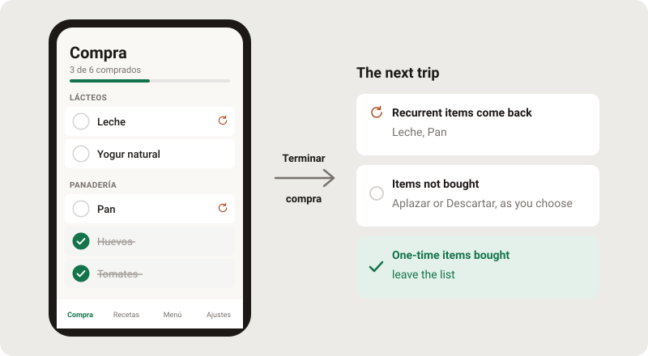
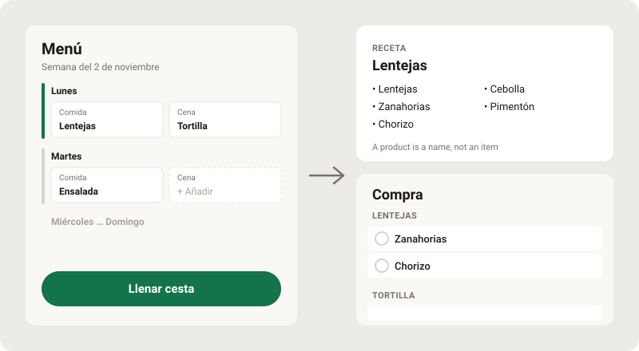
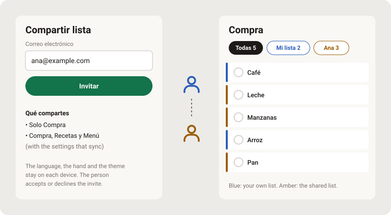
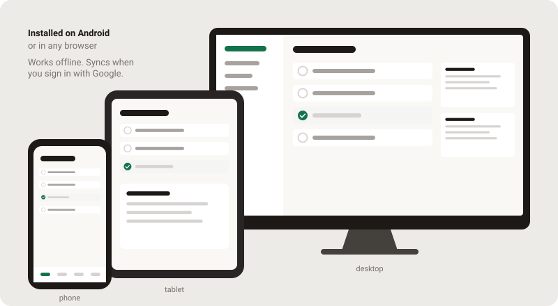

# Bodega

A shopping list that works offline. It is mobile first: install it as a PWA on an Android phone,
or use it in any browser, on a phone, a tablet or a desktop. It keeps one list, `Compra`, for the
current trip. At the end of a trip it keeps the recurrent items and, if you choose, the items you
did not buy, so the list for the next trip is almost ready.

- App: https://bodega.artisandevs.duckdns.org/
- Specification: [`docs/spec/`](docs/spec/README.md). Each rule has an identifier, such as `TRIP-2`.
- Changes by version: [`CHANGELOG.md`](CHANGELOG.md). What a user reads in the app:
  [`release-notes/`](release-notes/).

## What it does

### One list for the trip

`Compra` holds what to buy. Add an item with search, with no duplicates, then tick it in the shop.
Search the list, order it by name or by hand, and group it by recipe, by shop or by store
section. **Terminar compra** ends the trip: recurrent items (↻) come back for the next trip, the
one-time items you bought leave the list, and the items not bought stay or go, as **Al terminar
la compra** in `Ajustes` sets. `Deshacer` restores the list for 5 seconds.



### Recipes and the menu of the week

A recipe is a name and a list of products. One tap sends its products to `Compra`. In `Menú`, put
a recipe or a dish in the lunch and the dinner of each day. **Llenar cesta** sends the products of
all the recipes of the week to `Compra`, with no duplicate item.



### Share with another person

Invite a person by email in **Compartir lista**. Share `Compra` only, or `Compra`, `Recetas` and
`Menú`. The person accepts or declines. A member sees their own list beside the shared one, with a
chip for each: **Todas**, **Mi lista** and the name of the owner. The language, the hand and the
theme stay on each device.



### Any device, online or not

Bodega is mobile first. Install it on an Android phone, or open it in any browser on a phone, a
tablet or a desktop; the layout adapts to each width. It works with no connection after the first
load. Sign in with Google to sync the data between your devices, or use the app with no account.



### More

- **Shops and sections** — give an item its shops and its section of the store, then see the list
  for one shop or in the order of the walk through the store.
- **Backup** — export the data to a JSON file and import it again.
- **Languages** — Spanish, Catalan, English, French, German, Italian and Portuguese.
- **Integrations** — launcher shortcuts, a reminder at the shop opened by an automation app
  (`?arrival`), and voice commands in Spanish.
- **Walkthrough** — a new install starts with six pages that teach the app.

Not in the product, by decision: quantities, units, prices, photos, more than one list for the
trip, a history of past trips, and system notifications. The full list is in
[01-product](docs/spec/01-product.md).

## Use it

In a browser, open the app URL. The layout adapts to a phone, a foldable, a tablet and a desktop,
and works with a mouse and a keyboard.

To install it on Android:

1. Open the app URL in Chrome.
2. Open the Chrome menu and tap **Add to Home screen → Install**, or tap **Install the app** in
   `Ajustes`.
3. Start the app from the home screen. It works with no network connection after the first load.

The data lives on the device first, in the `localStorage` of the browser. With an account it also
syncs to the server. Without an account, **Clear site data** in Chrome and the uninstall of the
app delete the lists: export a backup in `Ajustes` before you do that.

The app moved from `https://gekyzo.github.io/pwa-shopping-list/`. The old address shows a screen
with **Mover mis datos**, which carries the data to the new address
([20-address](docs/spec/20-address.md)).

## Specification

| Subject | Document |
|---|---|
| Purpose, user, constraints, what the app does not do | [01-product](docs/spec/01-product.md) |
| The list `Compra`, the trip and the add sheet | [03-lists](docs/spec/03-lists.md) |
| Order, groups, shops and store sections | [04-arrange](docs/spec/04-arrange.md), [05-shops](docs/spec/05-shops.md), [17-aisles](docs/spec/17-aisles.md) |
| Recipes and the menu of the week | [06-recipes](docs/spec/06-recipes.md), [13-menu](docs/spec/13-menu.md) |
| Sections, gestures, messages, undo and the walkthrough | [07-screen](docs/spec/07-screen.md) |
| Accounts, sync and sharing | [18-account-sync](docs/spec/18-account-sync.md), [19-sharing](docs/spec/19-sharing.md) |
| The stored format and the backup | [02-data-model](docs/spec/02-data-model.md), [08-storage](docs/spec/08-storage.md) |
| Languages | [09-languages](docs/spec/09-languages.md) |
| Offline use, version, update and installation | [10-offline-version](docs/spec/10-offline-version.md), [16-install](docs/spec/16-install.md) |
| Reminder at the shop, shortcuts and voice | [11-integrations](docs/spec/11-integrations.md) |
| The move to the new address | [20-address](docs/spec/20-address.md) |
| Modules, code rules, tests and the design system | [12-engineering](docs/spec/12-engineering.md), [15-design-system](docs/spec/15-design-system.md) |

The full index, with the rule prefixes and the words of the app, is
[`docs/spec/README.md`](docs/spec/README.md).

## Develop

Plain HTML, CSS and ES modules, with no build step and no dependencies. Node 20 or later.

```sh
npm run hooks    # enable the git hooks of .githooks/ (one time)
npm test         # unit tests
npm run serve    # http://localhost:8080
npm run pair     # two users on :8081 and :8082 (docs/two-users.md)
npm run release  # bump, commit and tag vX.Y.Z; git push --follow-tags deploys
```

A change of behaviour changes its rule in `docs/spec/` in the same commit. The deploy is in
[10-offline-version](docs/spec/10-offline-version.md) (VER-9), the design system in
[15-design-system](docs/spec/15-design-system.md).
